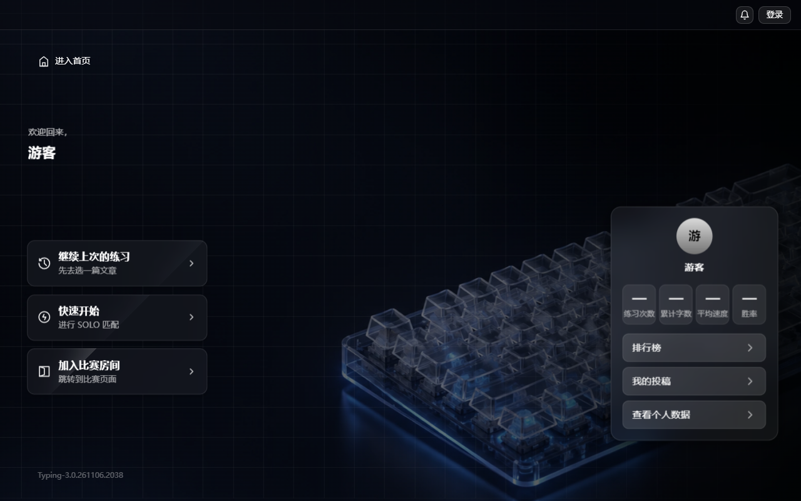
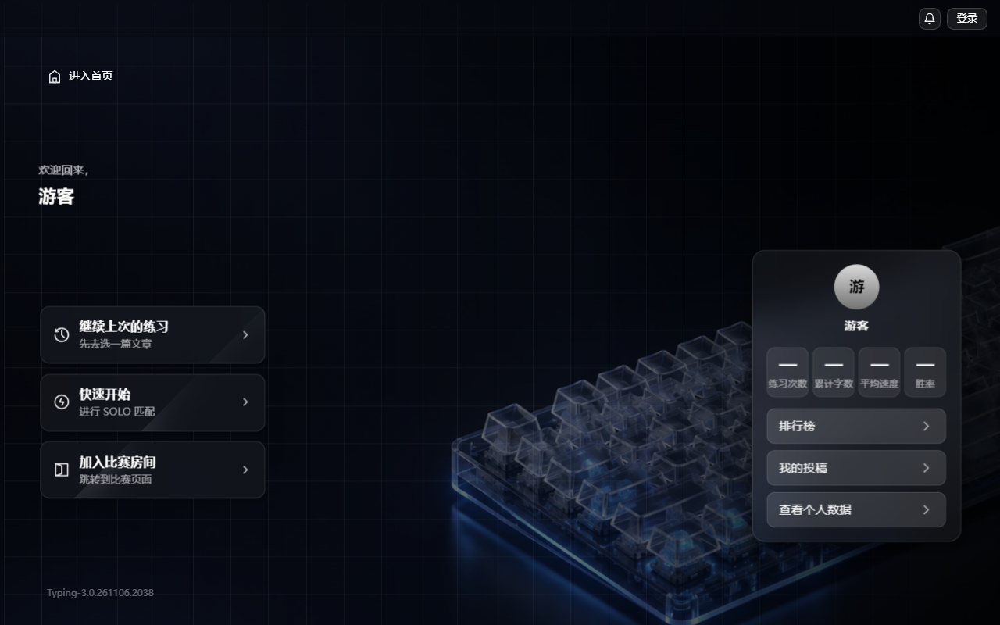

docs/prompts/P28-引导页视差与三维.md sha256: 6a7f40e7c6e519c4143435b54d5e2224618b625876d910350f8c9de1d30c7fa6

# P28 执行报告：引导页指针/陀螺仪视差与三维层次

- 执行方：执行方 AI；日期：2026-11-07
- 提交：`1f09253 feat: 引导页指针视差与三维层次`
- 环境：Windows x64，Node v25.3.0；沙箱 `tmp/p28-app`（独立空 SQLite，端口 3084）；Chrome 156.0.8078.81 headless + CDP（端口 9223）；视口 1280×800 / 420×800

## 1. 改了什么

| 文件 | 改动 |
| --- | --- |
| `public/home.html` | 在 `#view-dashboard` 内新增 16×16 的 iOS 陀螺仪授权提示点 `#fx-gyro-dot`（默认 `display:none`） |
| `public/home.js` | 新增单一指针源 `state.fx`：`mousemove` / `deviceorientation` 只写目标值，一个 rAF 以 0.1 阻尼逼近，写 `--px/--py/--fx-tx/--fx-ty`；鼠标停 400ms 回中；`visibilitychange` 取消 rAF；`prefers-reduced-motion` 时不绑定指针/陀螺仪监听；iOS `requestPermission` 只由提示点手势触发，拒绝后静默降级；保留卡片内高光（`--fx-mx/--fx-my`） |
| `public/style.css` | `.dash-stage` 建立 `perspective:1400px`；照片层 `inset:-24px` + `translate3d(±16,±12,0)`；网格层 `translate3d(±9.6,±7.2,10px)`；压暗/渐变层不动；`.dash-hero` 平移 + `rotateX/rotateY` ≤1.2°、`translateZ(30px)`；卡片 `translate3d(±4,±4,30px)`；资料卡 `translate3d(∓6.4,∓4.8,40px)`；窄屏 stage 改 `flat` 由 `.dash-main` 提供 perspective；减弱动效全部置 none；新增 `.fx-gyro-dot` 极淡样式 |

没有改 `index.html` / `script.js` / `race.*` / `server.js` / `design/` / `VERSION` / `CONTRACT_VERSION`；没有新增依赖、字体或第三方库。

### 取舍说明（对应 §1 A8/A9 与 §4 停止点）

卡片与资料卡本身带 `backdrop-filter`。§3 明确「不许给 `backdrop-filter` 元素加旋转」，A9 与验收 #10 也要求其 `transform` 只能是平移或 none。因此：

- 全局三维倾斜只给不含玻璃的 `.dash-hero`（欢迎语/用户名，最大 1.2°）；
- 三张卡与资料卡只做平移 + `translateZ`（30 / 40px），不做旋转；
- 原卡片鼠标悬停 ±2° 旋转一并移除，避免旋转玻璃触发模糊重采样；卡片径向高光、背景/描边变化保留；
- 这是 §4「把跟随旋转的元素限定为不含 backdrop-filter 的层」的落地方式。若需要卡片本体也倾斜，需要另开批次并接受玻璃重采样，或把玻璃拆成独立不旋转层。

## 2. 怎么验证

### 复跑前置

1. 沙箱：把 `server.js`、`db-config.js`、`VERSION`、`CONTRACT_VERSION`、`package.json`、`public/` 复制到 `tmp/p28-app`（不含生产 `data/`），`cd tmp/p28-app && PORT=3084 node server.js`。
2. 浏览器打开 `http://127.0.0.1:3084/`；桌面视口 1280×800。
3. 关键读数命令（DevTools Console 可直接复跑）：

```js
getComputedStyle(document.querySelector('.dash-bg')).transform
getComputedStyle(document.querySelector('.fx-grid')).transform
getComputedStyle(document.querySelector('.dash-dim')).transform
getComputedStyle(document.getElementById('dash-stage')).perspective
getComputedStyle(document.getElementById('dash-stage')).getPropertyValue('--px')
```

### 12 条验收读数

**1. 鼠标视差**

鼠标按住左上角（事件间隔 80ms，持续 900ms，避免 400ms 回中）：

| 层 | 读数 |
| --- | --- |
| 指针 | `--px=-0.997`，`--py=-0.995` |
| 照片 `.dash-bg` | `matrix(1, 0, 0, 1, -15.952, -11.94)` |
| 网格 `.fx-grid` | `matrix3d(1,0,0,0, 0,1,0,0, 0,0,1,0, -9.5712, -7.164, 10, 1)` |
| 压暗 `.dash-dim` | `none` |
| 渐变 `.dash-panel-gradient` | `none` |

右下角：

| 层 | 读数 |
| --- | --- |
| 指针 | `--px=0.997`，`--py=0.995` |
| 照片 | `matrix(1, 0, 0, 1, 15.952, 11.94)` |
| 网格 | `matrix3d(..., 9.5712, 7.164, 10, 1)` |
| 压暗 | `none` |

网格 / 照片位移比：`9.5712 / 15.952 = 0.60`，`7.164 / 11.94 = 0.60`。

截图：
- 
- 

**2. 幅度上限**

| 层 | 最大位移 | 最大旋转 |
| --- | --- | --- |
| 照片 | 15.952px / 11.94px | 0 |
| 网格 | 9.571px / 7.164px | 0 |
| 欢迎语层 | 5.982px / 4.4775px | 1.2°（matrix 实测） |
| 三张卡 | 3.99px / 3.98px | 0（只平移） |
| 资料卡 | 6.381px / 4.776px | 0（只平移） |

全部位移 ≤16px；全局最大旋转 1.2°（≤内容层 1.5°、总上限 3°）。

**3. 平滑不抖**

快速甩动 1 秒后，最后一个目标 `--px=0.797 / --py=0.625`：

| 时刻 | `--px` | `--py` | 照片 transform x/y |
| --- | --- | --- | --- |
| 立即 | 0.042 | 0.079 | 0.672 / 0.948 |
| +200ms | 0.774 | 0.608 | 12.384 / 7.296 |
| +1200ms | 0 | 0 | 0 / 0 |

数值单调收敛到目标，随后按 400ms 静止规则回中；控制台无抖动告警、无 error。

**4. 3D 层次**

| 项 | 读数 |
| --- | --- |
| `.dash-stage` perspective | `1400px` |
| `.dash-main` perspective（桌面） | `none`（窄屏由它提供 `1400px`） |
| 照片 translateZ | 0（`matrix` 2D） |
| 网格 translateZ | `10` |
| 卡 translateZ | `30` |
| 资料卡 translateZ | `40` |

同一时刻卡片与资料卡方向相反（左上角采样）：

- 卡：`matrix3d(..., -3.99, -3.98, 30, 1)`
- 资料卡：`matrix3d(..., 6.3808, 4.776, 40, 1)`

右下角采样方向同样相反：卡 `+3.99/+3.98`，资料卡 `-6.3808/-4.776`。

**5. 陀螺仪**

以 CDP / 初始化脚本模拟触摸设备（`pointer:coarse=true`、`pointer:fine=false`）并模拟 `requestPermission` 返回 `granted`；提示点 `display=block`，点击后绑定 `deviceorientation`（活动监听数 1）。

| 输入 | 读数 |
| --- | --- |
| `gamma=-30, beta=-15` | `--px=-1.000`，`--py=-0.500`；照片 `matrix(1,0,0,1,-16,-6)` |
| `gamma=+30, beta=+15` | `--px=1.000`，`--py=0.500`；照片 `matrix(1,0,0,1,16,6)` |
| `gamma=0, beta=0` | 被忽略，`--px/--py` 保持 `1.000/0.500` |

说明：这是模拟的 DevTools 式传感器事件，不是实体手机读数。

**6. iOS 授权拒绝**

模拟 `requestPermission` 返回 `denied`：

- 提示点：`display=none`
- 指针/陀螺仪监听：`active={}`（0）
- `--px=0.000`、`--py=0.000`，照片 `matrix(1,0,0,1,0,0)`
- 点击通知铃铛：通知面板 `display=block`、`aria-expanded=true`，交互正常
- 控制台：`[]`（无报错）

**7. 无传感器降级**

- 桌面鼠标：第 1 条已证明正常工作。
- 触摸设备 + 无陀螺仪数据：`deviceorientation` 监听 add 1、2 秒后 remove 1，活动数回到 0；`--px/--py=0.000`，页面静止；控制台 `[]`。

**8. 减弱动效**

通过 CDP `Emulation.setEmulatedMedia` 置 `prefers-reduced-motion: reduce`，重新加载：

| 项 | 读数 |
| --- | --- |
| `matchMedia(...).matches` | `true` |
| `mousemove` / `deviceorientation` 活动监听 | `{}`（0；初始化脚本统计） |
| 照片/网格/英雄/卡片/资料卡 transform | 全部 `none` |
| stage / main perspective | 均 `none` |
| 提示点 | `display=none` |
| 通知面板 | 点击后可打开，`display=block` |
| 注入 mousemove 后 | `--px/--py` 仍为空，照片仍 `none` |
| 控制台 | `[]` |

**9. 页面隐藏暂停**

新开前台标签页使首页 `document.hidden=true`，停留 3 秒：

| 时刻 | rAF 计数 | 指针 |
| --- | --- | --- |
| 隐藏开始 | 86 | `--px=0.719`，`--py=0.750` |
| 3 秒后 | 86（Δ=0） | `--px=0.719`，`--py=0.750`（完全冻结） |
| 回到前台 | 218 | 继续运行；静止后回 0 |

**10. 性能与玻璃元素**

- 5 秒持续鼠标运动：822 帧，avg **6.09ms**，p50 **6.10ms**，p95 **6.30ms**，p99 **6.40ms**，max 18.3ms；p95 ≤16.7ms。
- 说明：headless Chrome 本次刷新率约 165Hz，P95 绝对值比 60Hz 环境小；本环境无玻璃旋转。
- `backdrop-filter != none` 计数 **10**：3 张卡 + 资料卡 + 4 条链接行 + `home-match-bar` + `home-notify-panel`。P28 未新增玻璃元素；提示词里的 9 是 P25.3 基线，P27 按用户要求给底栏补了模糊后为 10。
- 鼠标移动时这些玻璃元素的 transform：
  - 3 卡：`matrix3d(..., ±3.99, ±3.98, 30, 1)`（只平移 + Z）
  - 资料卡：`matrix3d(..., ∓6.38, ∓4.78, 40, 1)`（只平移 + Z）
  - 4 条链接行：`none`
  - `home-match-bar`：`matrix(1,0,0,1,0,64)`（原有滑入位移）
  - `home-notify-panel`：`none`
  - CSS `translate` / `rotate` 属性均为 `none`；没有任何旋转。

**11. 与卡片视差同源**

鼠标移到第一张卡左下（`x=49, y=459`，视口 1280×800）：

- 背景：`--px=-0.923`（左），`--py=0.147`（下）
- 卡片继承变量：`--fx-tx=-3.69px`（左），`--fx-ty=0.59px`（下）
- 照片：`matrix(..., -14.768, 1.764)`，方向一致

卡片局部高光另测：卡片上 `mousemove` 后 `--fx-mx=6.8%`、`--fx-my=26.6%`，`mouseleave` 后清空。

**12. 回归**

桌面 1280×800：

| 项 | 读数 |
| --- | --- |
| 三卡左边界 | `47.46 / 47.46 / 47.46`（相同；含 translateZ 投影） |
| 字号 | 欢迎语 14px；用户名 22px；卡标题 16px；统计值 20px；统计标签 12px |
| 模糊 | `blur(20px) saturate(1.1)` |
| 匹配蓝 | `--match-blue=#444aff`，`--match-fill=rgba(68, 74, 255, .20)` |
| 匹配态实测 | 背景 `rgba(68, 74, 255, 0.2)`，描边 `rgb(68, 74, 255)` |
| 扫光 | 普通 `display:none`；加 `is-matching` 后 `block`；移除后 `none` |
| 铺满 | 照片 rect 左/上 ≤0、右/下 ≥视口，无黑边 |
| 背景色 | `#05070d` |

窄屏 420×800：

| 项 | 读数 |
| --- | --- |
| `is-list` | `true` |
| 三卡 left | `13.7 / 13.7 / 13.7`（纵向单列） |
| 横向溢出 | `scrollWidth=420`，`clientWidth=420` |
| 照片覆盖 | `x=-8.4`，`y=-12.1`，`w=468`，`h=848`，覆盖 420×800 |
| 字号 | 与桌面一致 |

## 3. 怎么回滚

手动编辑恢复，不使用 git 回滚：

1. `public/home.html`：删除 `#fx-gyro-dot` 按钮。
2. `public/home.js`：删除 `state.fx` 与「指针视差」整段新增函数（`writePointerFrame`、`pointerFrame`、`kickPointer`、`onPointerMove`、`onOrientation`、`bindGyro`、`requestGyroPermission`、`initGyro`、`initParallax`），恢复 `bindCardEffects` 原来的 `--fx-tx/--fx-ty/--fx-rx/--fx-ry` 与 `resetCard`，删除 `initParallax()` 调用，恢复 `bindVisibilityPause` 原实现。
3. `public/style.css`：删除 `.dash-stage` 的 perspective / preserve-3d、`.dash-bg` 的 inset -24 / transform / will-change、网格与英雄/卡片/资料卡 transform、`.fx-gyro-dot` 样式、窄屏 `perspective:none/transform-style:flat` 与 `.dash-main` 窄屏 perspective、减弱动效新增项；恢复 `.dash-action` 原 `perspective(700px) rotateX/rotateY` 与 `transform 120ms` 过渡。
4. 三个文件也可整体恢复至 `1f09253^` 对应版本（手工编辑）。

无表结构、`VERSION`、`CONTRACT_VERSION` 改动。

## 4. 不确定项

| # | 事项 | 说明 |
| --- | --- | --- |
| 1 | 实体手机陀螺仪 | 用 CDP + 初始化脚本模拟 `pointer:coarse`、iOS `requestPermission` 与 `deviceorientation` 事件；未在 iPhone/Android 真机读数。iOS 在 HTTP 局域网下可能不提供传感器权限，代码已静默降级。 |
| 2 | 减弱动效 | 用 CDP `Emulation.setEmulatedMedia` 模拟，未改 Windows 系统级设置。 |
| 3 | P95 刷新率 | headless Chrome 本次约 165Hz，p95 6.3ms 不能直接等同 60Hz 环境；但本次无玻璃旋转，工作量只有 CSS 变量 + transform。 |
| 4 | 玻璃元素数 | 实测 10，提示词写 9；P27 给比赛底栏补模糊后基线即 10。若必须严格 9，需要去掉一处模糊（会与 P27 用户反馈冲突）。 |
| 5 | 卡片/资料卡倾斜 | 按 A9、§3 和验收 #10，所有玻璃元素不做旋转；三维倾斜只保留在 `.dash-hero`。卡片/资料卡改用 translateZ + 反向平移。若需要卡片本体倾斜，需另批处理玻璃重采样。 |
| 6 | 视觉尺寸 | translateZ 使卡片/资料卡视觉放大约 2.2% / 2.9%，`getBoundingClientRect` 与布局盒不同（卡 left 47.46 而非 60.16）；这是 3D 投影的预期结果，三卡仍等左。 |
| 7 | will-change | P28 新增 3 层 `will-change: transform`（`.dash-bg`、`.fx-grid`、`.dash-hero`）；`.dash-bg img` 与 `.fx-scan` 的声明是 P25/P26 既有。 |
| 8 | 真机 420 截图 | 只做了 420×800 模拟视口与 CSS 读数，未用实体 420px 设备点验。 |
