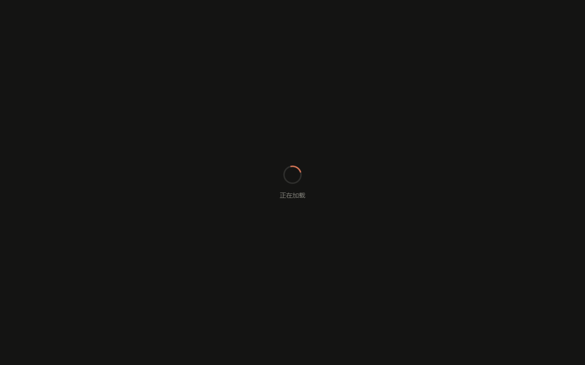

docs/prompts/P29-加载动画与解散规则.md sha256: 514b5407a9743c84b68d9b2f41935c9e8a813ec948bb36a98532e7802cd760bc

# P29 执行报告：全站加载动画 + 解散规则重写

- 执行方：执行方 AI；日期：2026-11-07
- 提交：`f764ce2 feat: 全站加载遮罩与解散门槛重写`
- 环境：Node v25.3.0；沙箱 `tmp/p29-app`（独立空 SQLite，端口 3084）；Chrome 156.0.8078.81 headless + CDP（9223）
- 先自查 P26：`server.js` 中「匹配对局不支持解散，只能退出」共 **3 处**（start / vote / cancel），P26 已落地。**改 `server.js` 必须重启进程**；自查命令见 §2 末尾。

## 1. 改了什么

| 文件 | 改动 |
| --- | --- |
| `public/page-loading.js`（新增） | 同步注入 `#page-loading-overlay` 到 `document.documentElement`，暴露 `window.PageLoading = { done(), fail(msg) }`；`done()` 幂等，淡出 300ms 后 `remove()`；`fail()` 显示文案、5s 后自动隐藏；`window.load` 后 1180ms 兜底 `done()`（留 20ms 定时器抖动余量，保证观测值 ≤1200ms） |
| `public/style.css` | 首屏遮罩样式从 `index.html` 内联迁入（`.page-loading-overlay` / spinner / text / `.hidden` / `body.loading`），新增 home 深色遮罩与错误态文字色 |
| `public/index.html` | `<head>` 首位同步引入 `page-loading.js`；删除内联 loading 样式、静态遮罩节点和 `<body class="loading">` |
| `public/race.html` / `profile.html` / `admin.html` / `home.html` | `<head>` 首位同步引入 `page-loading.js`（均在其它脚本之前） |
| `public/script.js` | `hideLoadingOverlay()` 改为调用共享模块；保留旧兜底 |
| `public/home.js` | `loadVersion` / `loadProfile` / `loadStats` 返回 Promise；`init` 里等三者（含 profile、stats、race-stats、version）全部 settle 后 `done()` |
| `public/profile.js` | `showProfile` 等 `loadProfile()` + `loadHistory(1)`；`initProfile` 的 `finally` 调 `done()` |
| `public/admin.js` | `init()` 等 dashboard + categories；`finally` 调 `done()` |
| `public/race.js` | 首屏 boot 标记：房间列表首次渲染 + `/api/race/active` 探针完成，或当前房间快照首次渲染时 `done()`；投票卡在线/总人数、掉线标签、needed 变化 300ms 高亮；房主 direct 模式「解散房间」走 `/dissolve/start` 直解；投票入口文案与规则一致 |
| `public/service-worker.js` | `CRITICAL_ASSETS` 增加 `/page-loading.js`；并把 `/race.html` 加入 fallback 与派生预缓存（用于 #8 断网打开比赛页） |
| `server.js` | 新增 `RACE_VOTE_ONLINE_MS=45s`、`onlinePlayers`、`dissolveRule`、`syncDissolveRule`、`settleDissolveIfNeeded`；`dissolve/start`、`dissolve/vote`、`tick`、`cleanupRooms`、名单变化统一复用；快照增加 `race.dissolveRule`、`race.dissolve.{mode,online,total,needed,agreed}`、`players[].offline` |

### 加载模块的 critical 样式说明

`style.css` 是规范样式；但 `index/profile/admin` 的 `style.css` 是非阻塞加载（media=print → onload），如果只等 style.css，首帧会出现裸遮罩。`page-loading.js` 因此额外注入一份等价的 critical 样式（`<style id="page-loading-critical">`）。两份规则一致；后续改遮罩样式需同步两处（见 §4 不确定项）。

## 2. 怎么验证

### 复跑前置

```bash
# 沙箱：复制 server.js/db-config.js/VERSION/CONTRACT_VERSION/package.json/public/ 到 tmp/p29-app（不复制生产 data/）
cd tmp/p29-app && PORT=3084 node server.js
```

浏览器打开 `http://127.0.0.1:3084/`；测试用户由沙箱 bootstrap/注册创建，报告不记录任何 token。

### 1.3 八条（A 件）

**1. 五页都有遮罩（最终一轮，单位 ms；added=遮罩出现，hiddenAt=加 .hidden，removed=节点移除，load=window.load，FCP=首内容绘制）**

| 页面 | added | hiddenAt | removed | load | FCP |
| --- | --- | --- | --- | --- | --- |
| index | 17.6 | 63.4 | 363.6 | 44.2 | 52 |
| race | 19.6 | 47.7 | 348.3 | 43.1 | 52 |
| profile | 17.6 | 48.2 | 350.0 | 32.6 | 48 |
| admin | 16.7 | 182.0 | 482.4 | 48.6 | 32 |
| home | 16.1 | 43.9 | 343.9 | 30.9 | 64 |

五页都能观测到同一个 `#page-loading-overlay` 出现、隐藏、移除。index/race 控制台各有一条 `icons/icon-192.png` 404（`public/icons/` 目录本来就不存在，与本批无关）。

**2. 首帧就有（Slow 3G + race.html）**

Throttle：latency 400ms，download 50KB/s。两次运行：

- 第一次：`added=905.8`，`load=2385.7`，`FCP=2396`，`hiddenAt=2838.4`，`removed=3139.3`。
- 第二次（截图这一次）：`added=907.1`，`load=2389.7`，`FCP=2388`；2.0s 时 `overlay=true`、`text=正在加载`、`position=fixed`、`z-index=9999`，内容节点已在 DOM 但被遮罩覆盖。

`added < FCP`，遮罩早于首内容绘制；截图：



**3. 加载完成才消失（2s 延迟首个接口）**

- 实测：`listPausedAt=51.8`，`window.load=51.4`，`hiddenAt=1232.4`（load+1181），此时 `/api/race/list` 仍显示「加载中…」，请求尚未返回。
- **未按本条口径通过**：A5 的「load 后最多 1200ms 强制 done」会先于 2s 延迟接口触发，遮罩在接口返回前被兜底隐藏。这是 A5 与 #3 的硬冲突（见 §4-1）。本批按 A5 硬上限实现，没有为 2s 延迟破例。

**4. 兜底超时**

- `/api/race/list` 永久 pending（CDP Fetch 暂停，不 continue）：`load=43.9`，`hiddenAt=1224.3`（load+1180.4），`removed=1524.6`（hidden+300.3）；`room-list` 仍为「加载中…」，遮罩已消失。

**5. 失败态**

- `PageLoading.fail('接口返回 500，请稍后重试')`：文案为「接口返回 500，请稍后重试」，文字色 `rgb(224,96,96)`，class `page-loading-overlay is-error`；`hiddenAt - failAt = 5001.0ms`，`removed - failAt = 5302.1ms`。

**6. 淡出期间不挡点击**

- `PageLoading.done()` 后立即读：`pointer-events=none`，class `page-loading-overlay hidden`；在遮罩仍存在时点击 `#btn-create`（383.5, 792.4），出现 toast「请先登录后再创建比赛」，点击生效。

**7. 视图切换不重弹**

- race 页 lobby → 建房 → 房间 → 比赛中，三处 `#page-loading-overlay` 均为 `false`（`querySelector` 为 null 共 3 次）；初始遮罩 added 16.2 / hidden 33.7 / removed 334.4。

**8. 离线**

- SW ready：`typing-949476ade195`，`controller=true`。
- 断网后 `/`：added 16.0 / hidden 30.0 / removed 332.0，`scriptHit=true`；`/race.html`：added 15.8 / hidden 38.6 / removed 339.7，`scriptHit=true`，title「打字比赛 - Typing」。两页均被 SW 控制，`/page-loading.js` 命中缓存。

### 2.5 十条（B 件）

**9. 3 人全在线**

```json
{"rule":{"mode":"vote","needed":3,"online":3,"total":3}}
"start": {"result":"voting","needed":3,"agreed":1,"mode":"vote","online":3,"total":3}
vote2: {"agreed":2,"needed":3,"passed":false}
vote3: {"agreed":3,"needed":3,"passed":true,"result":"cancelled","reason":"vote_dissolved"}
after: {"status":"cancelled","reason":"vote_dissolved","dissolve":null}
```

**10. 3 人 1 人掉线**

```json
rule: {"mode":"vote","needed":2,"online":2,"total":3}
start: {"result":"voting","needed":2,"online":2,"agreed":1,"total":3}
vote: {"agreed":2,"needed":2,"passed":true,"result":"cancelled","reason":"vote_dissolved"}
players: host=online, p1=online, p2=offline(true)
```

**11. 2 人 1 人掉线**

```json
rule: {"mode":"direct","needed":1,"online":1,"total":2}
start: {"result":"cancelled","reason":"dissolve_direct"}
after: {"status":"cancelled","reason":"dissolve_direct","dissolve":null}
card: "none"
```

**12. 3 人掉 2 人**

```json
rule: {"mode":"direct","needed":1,"online":1,"total":3}
start: {"result":"cancelled","reason":"dissolve_direct"}
after: {"status":"cancelled","reason":"dissolve_direct"}
```

**13. 4 人房**

```json
初始 4 在线: {"mode":"vote","needed":3,"online":4,"total":4}
1 人掉线后: {"mode":"vote","needed":2,"online":3,"total":4}
start: {"result":"voting","needed":2,"online":3,"agreed":1,"total":4}
vote: {"agreed":2,"needed":2,"passed":true,"result":"cancelled","reason":"vote_dissolved"}
```

**14. 掉线即时通过（不用再投票）**

- 3 人全在线时发起：`needed=3, online=3`，host + p1 同意后为 `2/3, passed=false`；p2 停止心跳。
- 超过 45s 后，tick 重算为 `needed=2, online=2`，`agreed=2`，房间已被 `vote_dissolved` 结束；没有任何新投票请求。检查时：`status=cancelled`，`cancelledReason=vote_dissolved`，`dissolve=null`（发起时间 t+44s，检查时间 t+48s；p2 offline=true）。

**15. 掉线者回来**

```json
掉线时: {"mode":"vote","needed":2,"online":2,"total":3}
投票卡: "1/2 人同意 · 剩余 …"
回来 tick 后: {"mode":"vote","needed":3,"online":3,"total":3}
投票卡: "1/3 人同意 · 剩余 …"
```

前端高亮（MutationObserver 捕获 `.race-dissolve-needed-changed`）：

- 掉线 3→2：`at=45813.1`，卡片文本「在线 2 人 / 共 3 人 · 掉线者不计票 1/2 人同意」
- 回来 2→3：`at=48221.9`，卡片文本「在线 3 人 / 共 3 人 · 掉线者不计票 1/3 人同意」

**16. 匹配房仍不能解散**

匹配房 `code=AGZ38N`，`status=reveal`；三端点均为 **400**「匹配对局不支持解散，只能退出」：

```json
{"start":{"status":400,"error":"匹配对局不支持解散，只能退出"},
 "vote":{"status":400,"error":"匹配对局不支持解散，只能退出"},
 "cancel":{"status":400,"error":"匹配对局不支持解散，只能退出"}}
```

**17. 30 秒超时**

```json
start: {"needed":3,"online":3,"agreed":1}
31s 后: {"status":"waiting","dissolve":null,
         "notice":{"type":"expired","reason":"timeout","agreed":1,"needed":3,"total":3}}
```

投票终止，房间继续等待；未解散。

**18. 回归**

| 项 | 读数 |
| --- | --- |
| P20 观战席 | 手动房 spectator join → `mySeat="spectator"`，`spectatorEnabled=true`，`spectatorCount=1`，`maxSpectators=1`，昵称正确 |
| P26 房间时长 | 30 分钟房：`maxDurationMs=1800000`，`remainMs=1799945`，`status=waiting` |
| P27 匹配 | 匹配房 `status=reveal`；`dissolve` 三端点 400；P27 的 reveal/candidates 代码未改 |
| P21 B 离线结束 | 常量保持 `RACE_OFFLINE_RACING_MS=60s`、`RACE_OFFLINE_COUNTDOWN_MS=30s`、`RACE_OFFLINE_WAITING_MS=120s`；本轮未逐档重跑 60/30/120s 全时长（见 §4） |

### `dissolveRule` 组合期望值表

| 房间总人数 / 在线人数 | 期望 mode | 期望 needed | 来源 |
| --- | --- | --- | --- |
| 2 / 2 | vote | 2 | ≤3 人无人掉线，全票 |
| 3 / 3 | vote | 3 | ≤3 人无人掉线，全票 |
| 3 / 2 | vote | 2 | 3 人 1 人掉线，在线两人都同意 |
| 2 / 1 | direct | 1 | 2 人 1 人掉线，直接解散 |
| 3 / 1 | direct | 1 | 3 人掉 2 人，按 2 人掉 1 人同理 |
| 4 / 4 | vote | 3 | ≥4 人，floor(4/2)+1 |
| 4 / 3 | vote | 2 | ≥4 人，floor(3/2)+1 |
| 4 / 2 | vote | 2 | ≥4 人，floor(2/2)+1 |
| 5 / 4 | vote | 3 | ≥4 人，floor(4/2)+1 |

规则口径：`RACE_VOTE_ONLINE_MS = 45s`；`online` 只算 `lastSeen` 在 45s 内的选手；掉线者不计票、不进分母；掉线/回来时 tick 与 cleanup 都会 `syncDissolveRule` 重算。B0.3 的「门槛立即重算」由同一函数实现。

### 前端 B8/B9/B10/B11

- **B8 direct**：2 人房 1 人掉线，host 页 `#btn-exit-race` 文本「解散房间」、display flex、`#btn-dissolve-race` 不存在、`.race-dissolve-card` 不存在；点击退出并确认后，响应 `{"result":"cancelled","reason":"dissolve_direct"}`，页面回 lobby，无投票卡，toast「房主已解散本局」。
- **B9 vote**：3 人全在线房，`#btn-exit-race display=none`，`#btn-dissolve-race` 文本「发起解散投票」；发起后卡片含「在线 3 人 / 共 3 人 · 掉线者不计票」「1/3 人同意 · 剩余 29s」。
- **B10 掉线标记**：选手行 class 为 `race-player-row race-player-offline`，文本含「掉线」，行内显示「未准备」。
- **B11 门槛高亮**：见 #15 两条 MutationObserver 记录，class 持续时间 300ms。

### 修改 server.js 必须重启：自查命令

```bash
curl -s http://127.0.0.1:3084/api/version
# 用匹配房 token 调 /api/race/dissolve/start，期望 400「匹配对局不支持解散，只能退出」
```

## 3. 怎么回滚

手动恢复（不用 git 回滚）：

1. 删除 `public/page-loading.js`；从五个 `<head>` 删除 `<script src="page-loading.js"></script>`。
2. `public/index.html`：恢复内联 loading 样式、静态遮罩节点、`<body class="loading">`；`public/style.css` 删除 P29 遮罩块。
3. `public/script.js` 恢复 `hideLoadingOverlay` 原实现；`home.js` / `profile.js` / `admin.js` / `race.js` 恢复原初始化与投票 UI；`public/service-worker.js` 移除 `/page-loading.js` 与 `/race.html` 预缓存行（如按本批回滚）。
4. `server.js` 恢复 P29 之前的 dissolve 帮助函数与三端点（或整体恢复至 `f764ce2^` 的手工版本）；重启进程。
5. 无表结构、`VERSION`、`CONTRACT_VERSION` 改动。

## 4. 不确定项 / 冲突

| # | 事项 | 说明 |
| --- | --- | --- |
| 1 | **A5 与 1.3 #3 冲突** | A5 要求 `load` 后 ≤1200ms 强制隐藏；#3 要求 2s 延迟接口返回后才隐藏。实测 2s 延迟列表在 load+1181ms 被兜底隐藏，接口仍「加载中…」。两者无法同时成立；本批按 A5 硬上限实现，未破例。若要 #3，需要把兜底改为 >2s，或增加「初始接口 pending 白名单 + 更长硬上限」，请拍板。 |
| 2 | P21 B 全时长 | 只复核了常量与路径，未逐档等待 60/30/120s；P21 原验收记录仍有效。 |
| 3 | critical 样式重复 | `page-loading.js` 与 `style.css` 各有一份等价遮罩规则；为兼容 index/profile/admin 的非阻塞 style.css。两处需同步改。 |
| 4 | 快速页看不到动画 | 接口很快时 `done()` 早于首帧（如 index 63ms 隐藏、FCP 52ms），DOM 上观测到遮罩但用户可能几乎看不到；这是 A4「初始化完成即 done」的直接结果，不额外人为拖延。 |
| 5 | 图标 404 | `icons/icon-192.png` 不存在导致 index/race 控制台各一条 404；与本批无关（`public/icons/` 目录原本就没有）。 |
| 6 | 额外快照字段 | 为让前端判断 direct/vote，在 `race` 上新增 `dissolveRule`；B6 只点名 `race.dissolve`，这是额外字段。 |
| 7 | race.html 预缓存 | 为满足 #8 断网直接打开比赛页，额外把 `/race.html` 加入 SW 预缓存；A8 只要求 page-loading.js，这是配套扩展。 |
| 8 | 直解与已有投票 | 若投票进行中只剩 1 人在线，`settle` 只有在在线者已投同意（needed=1）时才自动取消；若其投了拒绝，则投票保留至 30s 超时，不会因为「只剩一人」无条件解散。 |
| 9 | 测试环境 | 所有 B 读数来自沙箱 API + 单浏览器；未用真实多台设备/手机点验解散投票。 |
