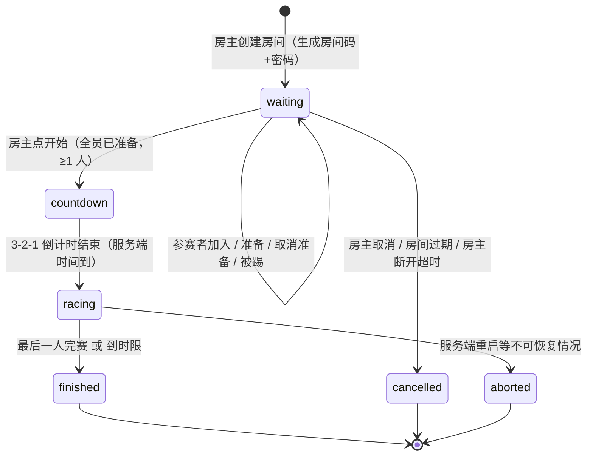
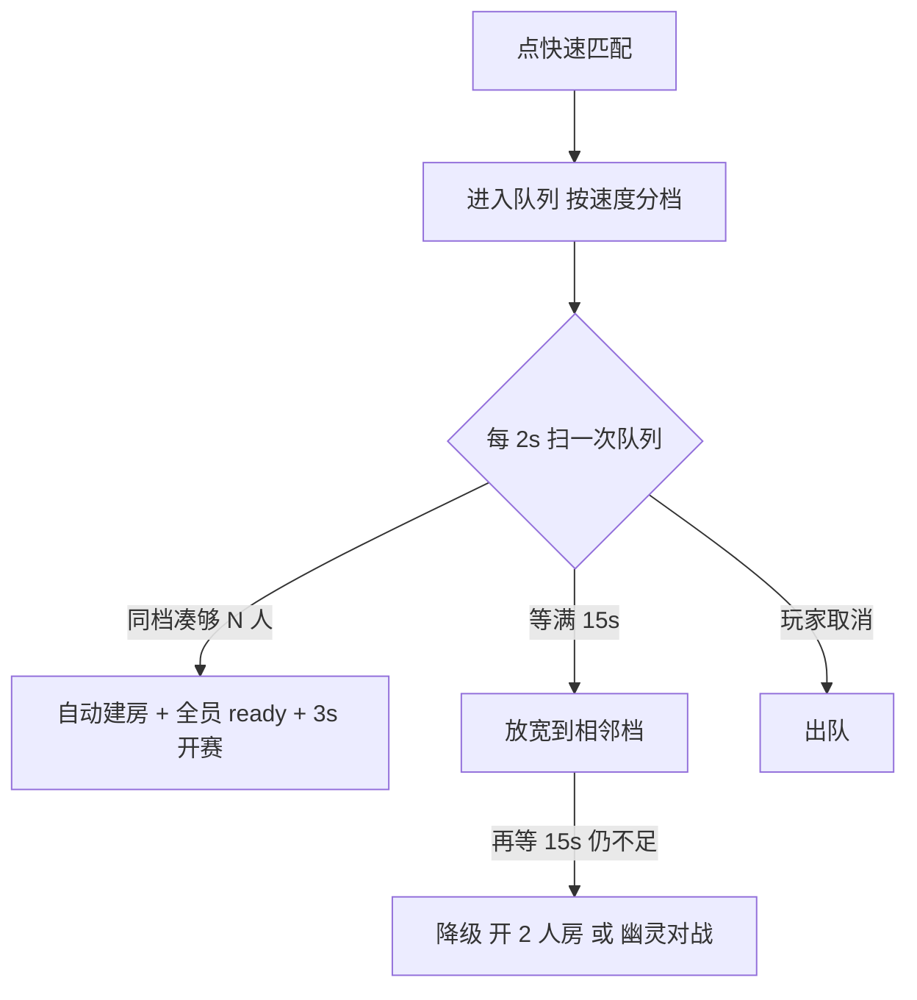
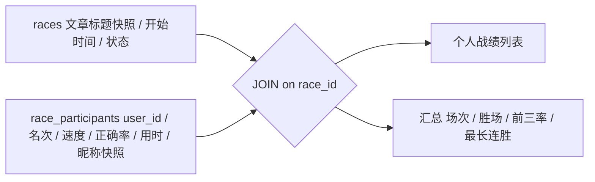

# 比赛模式（多人竞速）需求与设计

> 状态：**待用户拍板**。本文只做规划，不含实现；实现走 P12 起的提示词。
> 说明：本轮我的运行环境没有联网工具，**无法在线检索**。下文引用的行业惯例（TypeRacer 式房间竞速、Kahoot 式大厅准备、Jackbox 式房间码）来自既有认知，未做联网核对；如需严格比对某个产品的交互，请给我具体网址或截图。

## 1. 目标与非目标

**目标**：在现有站点里加一个「创建房间 → 邀请 → 大厅准备 → 同步开赛 → 实时排名 → 结算」的多人竞速玩法，最多 8 人同场，局域网内可用。

| 做 | 不做（V1 明确排除） |
| --- | --- |
| 房间码 + 密码加入、房主选文章、准备/开始、实时排名、赛果结算 | 观战席、房间内聊天、语音、赛季/积分、段位、回放、自定义文本、队伍模式 |
| 复用现有文章库与打字组件 | 新建文章格式、独立编辑器 |

## 2. 角色与流程

| 角色 | 能做什么 |
| --- | --- |
| 房主（创建者，必须登录） | 选文章、设人数上限与密码、踢人、开始比赛（所有人已准备时可用）、取消房间 |
| 参赛者（必须登录） | 用房间码+密码加入、准备/取消准备、比赛中输入、查看排名、赛后可再来一局 |



## 3. 界面规划

### 3.1 大厅（等待房间）

| 区域 | 内容 |
| --- | --- |
| 顶部条 | 复用站点导航；副导航页标写「比赛 · 房间 ABC123」 |
| 房间卡 | 房间码（大号等宽、可点击复制）、文章标题、字数、难度、人数 x/8、房主名 |
| 参赛者列表 | 每人一行：昵称、房主标记、**准备/未准备**状态；房主行有「踢出」按钮 |
| 底部动作区 | 参赛者：「准备」/「取消准备」；房主：「开始比赛」（全员准备前禁用并说明原因）、「更换文章」「取消房间」 |
| 无 | 不做聊天框 |

### 3.2 比赛界面（桌面，宽度 ≥1024px）

| 区域 | 宽度 | 内容 |
| --- | --- | --- |
| 左栏（信息 + 排名） | 固定 340px | ① 文章标题、字数、难度、剩余时间或已用时长 ② **实时排名**（昵称 / 进度条% / 已用时间；已完赛者标「完成 42s」，未完成按进度排序） ③ 当前速度与本场最好速度 |
| 右侧（输入区） | 剩余宽度（约 **2/3**） | 正文显示 + 输入区，复用现有打字组件的视觉（字符逐位高亮、错字标红、光标）；此处**禁止任何动效/过渡**（同首页打字区红线） |

（用户原文「约占 3/2」按 **2/3** 理解，左 1/3 右 2/3；如你要的是右侧占 60% 或 66%，拍板时说明。）

### 3.3 响应式

| 断点 | 布局 |
| --- | --- |
| ≥1024px | 左 340px + 右自适应（2/3） |
| 768–1023px | 左栏 280px + 右自适应 |
| <768px | 上下堆叠：排名折叠成可展开的条（默认收起，只显示「第 3/8 · 62%」），正文输入占满 |

### 3.4 结算

竖排结果卡：名次 / 昵称 / 速度(字-分) / 正确率 / 用时；自己那行高亮；底部「再来一局」（房主可原地重开，同一房间码继续用）与「返回首页」。

## 4. 数据模型（新增 2 张表）

| 表 | 关键字段 | 说明 |
| --- | --- | --- |
| `races` | `id`、`code`（6 位，唯一）、`password_hash`、`host_user_id`、`article_id`、`content_snapshot`、 `status`（waiting/countdown/racing/finished/cancelled/aborted）、`max_players`、`started_at`、`finished_at`、`created_at` | `content_snapshot` 在开赛瞬间快照正文：比赛中文章被改/下线/删除都不影响公平性 |
| `race_participants` | `race_id`、`user_id`、`ready`、`progress`（已正确输入的字符数）、`finished_at`、`speed`、`accuracy`、`rank`、`joined_at` | 主键 `(race_id, user_id)`，天然防重复加入 |

约束与索引：

- `races.code` 唯一索引；`status` 索引用于清理扫描。
- 外键：比赛成绩引用 `user_id`（`ON DELETE CASCADE`：用户被删则退出比赛）、`article_id`（`ON DELETE SET NULL`，因为已有快照）。
- **这是表结构变更**：按契约要升 `CONTRACT_VERSION` v2 → **v3** 并写 §5.5 与 ADR-0003（迁移为纯新增表，不动旧表）。

赛果是否写总榜：**建议写**，进 `scores` 且 `source='race'`，共享现有排行榜与个人统计；速度由服务端计时算出，天然满足 K-04 的复算要求。

## 5. 接口契约（全部需要登录，复用 `authMiddleware` 含 token_version 校验）

| 方法 | 路径 | 作用 | 关键规则 |
| --- | --- | --- | --- |
| POST | `/api/race/create` | 建房 | 入参 `{article_id, password, max_players}`；返回 `{code}`；同一用户同时只能主持 1 个房间 |
| POST | `/api/race/join` | 加入 | 入参 `{code, password}`；密码错**统一文案**、按 `ip|code` 限流 5 次/10 分钟；满员 400；比赛中加入 400 |
| POST | `/api/race/leave` | 主动退出 | 房主退出 = 取消房间（需二次确认） |
| POST | `/api/race/ready` | 准备/取消 | 入参 `{ready}`；只在 `waiting` 阶段有效 |
| POST | `/api/race/start` | 开赛（房主） | 全员已准备且 ≥1 人；把正文写入 `content_snapshot`，置 `countdown`，服务端记 `startsAt = now + 3000ms` |
| POST | `/api/race/kick` | 踢人（房主） | 不能踢自己；仅 `waiting` 阶段 |
| POST | `/api/race/tick` | **心跳 + 进度 + 快照** | 入参 `{progress?}`，返回整份房间快照。客户端每 **1.2s** 调一次，比赛与大厅共用 |
| POST | `/api/race/finish` | 完赛 | 只传 `{accuracy}`；**速度由服务端算**：字数 ÷ (服务端收到时间 − 服务端 `startsAt`) |
| POST | `/api/race/rematch`（V2） | 原地再来一局 | 保留房间码，重置参与者状态 |

快照响应形状（`tick` 返回，前端只依赖这一个结构）：

```json
{
  "race": { "code": "ABC123", "status": "racing", "articleTitle": "…", "charCount": 421,
             "maxPlayers": 8, "hostUserId": 2, "startsAt": 1762435203000, "serverNow": 1762435201200 },
  "me":   { "userId": 7, "ready": true, "progress": 128, "finishedAt": null, "rank": 3 },
  "players": [ { "userId": 2, "nickname": "Luca", "isHost": true, "ready": true,
                 "progress": 240, "finishedAt": null, "rank": 1 }, … ]
}
```

## 6. 实时机制：为什么 V1 用轮询而不是 WebSocket/SSE

| 方案 | 代价 | 结论 |
| --- | --- | --- |
| WebSocket（socket.io 等） | **引入白名单外的依赖**，且要处理升级/心跳/重连 | 否决 |
| SSE（原生 `EventSource`） | 零依赖但有个硬坑：**`EventSource` 不能自定义请求头**，JWT 只能塞进 URL（会进访问日志与历史记录）；还要绕开 `compression` 中间件对 `text/event-stream` 的缓冲 | V2 可选 |
| **轮询（1.2s）** | 8 人 × 0.83 次/秒 ≈ **7 请求/秒**，SQLite 单机完全吃得下 | **V1 采用** |

轮询实现要点：

- 一次往返同时「上传进度 + 拉快照」= `POST /api/race/tick`，避免双请求。
- **时钟对齐**：快照里带 `serverNow`，`startsAt` 是服务端毫秒时间戳；前端用 `offset = serverNow - Date.now()` 校正倒计时，避免各机时钟不同步导致有人抢先 1 秒。
- 页面不可见（`document.hidden`）时降频到 3s；切回来立即补一次。
- 断线自动重试（指数退避 1s/2s/4s，上限 8s），重连成功后用 `tick` 快照恢复现场，不弹重连面板。

## 7. 公平性与防作弊

| 手段 | 做法 |
| --- | --- |
| 起跑一致 | 统一用服务端 `startsAt`，客户端只负责显示；倒计时结束前输入一律不计数 |
| 计时不可伪造 | 完成时间以**服务端收到 `finish` 的时间**为准，客户端不报时间也不报速度 |
| 进度单调 | `progress` 只增不减（服务端取 `max(旧值, 新值)`），上限 ≤ 字数 |
| 超速判定 | 完赛时若速度 > 合理阈值（如 1200 字/分）标记 `source='race_suspect'` 并只记日志不拒收，避免误伤真实高手 |
| 一人一房 | `(race_id, user_id)` 主键 + 「同一用户同时只能在 1 个房间」约束 |
| 密码抗枚举 | 密码错误统一返回「房间不存在或密码错误」，按 `ip|code` 限流，房间码 6 位且不提供房间列表接口 |

## 8. 生命周期与清理

| 情形 | 处理 |
| --- | --- |
| 无人开赛 | 创建后 **2 小时**未开赛 → 标记 `cancelled`（复用现有定时清理机制，单一路径） |
| 房主断线 | 5 分钟内回来可继续（`tick` 快照恢复）；超过 5 分钟 → 取消房间并告知参赛者 |
| 服务端重启 | `racing` 且 `started_at` 在 30 分钟内的房间标记 `aborted`，前端提示「比赛已中断」 |
| 参赛者掉线 | 保留席位与进度 5 分钟；完赛判定等最后一人或到时限（字数 × 2 分钟上限） |
| 全员完赛 | 立即 `finished`，写赛果与 `scores` |

## 9. 前端改动面

| 文件 | 改动 |
| --- | --- |
| `public/race.html`（新增） | 大厅与比赛两态同页切换，减少一次跳转 |
| `public/race.js`（新增） | 轮询循环、状态机渲染、输入采集、倒计时 |
| `public/style.css` | 追加比赛专用样式段（复用现有令牌；打字区沿用 `--font-mono` 与现有字符高亮类） |
| `server.js` | `HTML_PAGES` 增加 `/race.html`；新增 9 个端点与清理定时器 |
| `db-config.js` | 两张新表 + 迁移 |
| 三个页面导航 | 加「比赛」入口（与现有 nav 一致） |

## 10. 验收口径（不写测试代码，全部可复跑）

1. 双人手动全流程：A 建房 → B 加入（错密码先试一次）→ 双准备 → 开赛 → 倒计时同步 → 双方输入 → 结算名次正确。
2. 脚本模拟 8 人 `tick`：并发 8 个循环各 20 次，**房间不串味**（每人快照里只有本房间 8 人）；服务端日志无异常。
3. 断线恢复：比赛中把 B 的标签页关掉再打开 `/race.html`，5 分钟内应自动回到原房间并恢复进度。
4. 公平性：A 的机器时钟往前拨 30 秒，A 不得提前开始计时。
5. 满员与状态：第 9 人加入 → 400；开赛后加入 → 400；已开赛再点准备 → 400。
6. 房主取消 / 踢人 / 过期：三条都要看到参赛者端提示，且房间不可再加入。
7. 赛果落库：“`scores` 表出现 source='race' 的行、速度与用时可复算（字数 ÷ 时长 ±1）”；总榜与个人统计自动包含该场。
8. 回归：首页打字、排行榜、个人中心统计（K-25 已修）不受影响；打字区仍无动效。

## 11. 分批计划

| 批次 | 内容 | 预估 |
| --- | --- | --- |
| **P12** 数据与房间生命周期 | 两张表 + 迁移、建房/加入/退出/准备/踢人/开始、房间过期清理、契约升 v3 + ADR-0003 | 后端为主，可先用 `curl` 验收 |
| **P13** 大厅界面 | `race.html` 大厅态、房间码复制、成员列表、准备/开始交互 | 前端 |
| **P14** 比赛与结算 | 倒计时、进度上报、实时排名、完赛、结算与写 `scores` | 前后端 |
| **P15**（可选） | 再来一局、观战、SSE 推送替代轮询 | 视你的反馈 |

## 12. 待你拍板的问题

| # | 问题 | 我的建议 |
| --- | --- | --- |
| 1 | 参赛资格：仅登录用户 / 也允许游客？ | **仅登录**（成绩要归属，且防刷更简单） |
| 2 | 单房间人数上限 | **8 人**（局域网场景），上限写入房间设置 |
| 3 | 密码形式 | **4 位数字**（好口头传），服务端只存 bcrypt 哈希 |
| 4 | 排名依据 | **按完赛时间**（打字赛惯例）；未完赛者按进度% |
| 5 | 赛果是否进总排行榜 | **进**，标 `source='race'` |
| 6 | 是否做观战 | **V1 不做** |
| 7 | 实时机制 | **轮询 1.2s**（零新依赖）；要更实时我再上 SSE（需处理 token 与压缩坑） |
| 8 | 右侧输入区占比 | 按 **2/3**（你说的是 3/2） |
| 9 | 房主能否选「随机文章」 | 建议加一个「随机」选项，零成本 |
| 10 | 比赛中文字被管理员下线/删除 | 已用开赛快照兜住，比赛不受影响（仅提示房主） |

## 13. 风险与已知坑（实现时要盯）

1. **`compression` 中间件会缓冲事件流**：将来上 SSE 必须对该路由禁用压缩并 `flushHeaders`。
2. **`EventSource` 无法带头**：token 只能进 URL → 若要 SSE，用一次性短票（60s）而非直接放 JWT。
3. **本机时钟不可信**：所有时间以服务端为准，前端只做显示偏移校正。
4. **轮询与打字输入的竞态**：进度上报不能阻塞本地输入渲染，也不要把输入框状态重置。
5. **房间码碰撞**：生成后必须查库重试（6 位 32 字符表 ≈ 10 亿组合，但要有重试而非假定唯一）。
6. **SQLite 并发写**：8 人每 1.2s 一次写（进度更新）≈ 7 写/秒；`WAL` 模式下没问题，但不要在该路径开事务里做重活。


---

## 14. 同一站点承载多个比赛（追加，2026-11-08）

### 14.1 结论：能，但架构要从「数据库当状态」改成「内存当状态、数据库当档案」

上一版把进度写进 `race_participants.progress`，单房间没问题；一旦同时开 10 个房间，每 1.2s 一次全量写就变成每秒几十次写库。改成：

| 层 | 存什么 | 特性 |
| --- | --- | --- |
| **内存**（`Map<code, room>`） | 进行中的房间：状态机、参与者、进度、倒计时、快照正文 | 读写在进程内，微秒级；按房间码 O(1) 定位 |
| **数据库** | 房间档案与赛果：建房时插一行、结束后回写结果与每人名次 | 只在状态跃迁时写，正常一场比赛全程只写 2~3 次 |

好处：8 人房每 1.2s 的进度更新完全不碰磁盘；服务端重启的可恢复性用「进行中的房间标记为 aborted」兜住（已写进 §8）。

**硬约束**：房间状态在进程内存里，**只支持单实例部署**。本项目是局域网单机 + SQLite，本来也不做多进程；将来若要横向扩展必须引入共享状态（Redis 之类，白名单外），现在明确不支持。

### 14.2 容量估算（LAN 单机，Node 25 + SQLite WAL）

| 指标 | 取值 | 依据 |
| --- | --- | --- |
| 单房间人数 | 8 | 一屏能看清排名，超了要滚动，体验变差 |
| 同时进行房间 | **20** | 20 × 8 = 160 玩家上限 |
| 并发玩家软上限 | **100** | 轮询请求 ≈ 玩家数 ÷ 1.2 ≈ **84 req/s**；每个请求只做「读内存 + 序列化 8 人快照」，纯 CPU 轻活 |
| 每秒写库 | ≈ 0 | 只在状态跃迁时写，这是 14.1 改造的直接收益 |
| 内存占用 | 每房间约 30KB（正文快照 ~2KB + 8 个参与者对象），20 房 < 1MB | 可忽略 |

**背压与降级**：

1. 达到软上限 → 建房返回 400「当前比赛房间已满（20/20），请稍后再试」，不做无限排队。
2. 轮询频率由服务端下发（正常 1.2s，房间数 > 15 时放宽到 1.8s），避免自己把自己压垮。
3. 上限放 `settings` 表（`race_max_rooms`），不写死在代码里，方便按机器能力调。

### 14.3 管理端可见性（低成本，值得做）

管理面板「概览」加一行只读信息：**当前房间数 / 在线比赛人数 / 最高单房人数**，数据来自内存注册表。管理员能看见现在有人在用，不用猜。

## 15. 房间大厅与匹配

### 15.1 房间可见性（解决「怎么找到别人的比赛」）

| 类型 | 创建时勾选 | 别人怎么进 |
| --- | --- | --- |
| **公开房**（默认） | 公开 | 出现在「比赛大厅」列表里，一键加入（不再输密码） |
| **私人房** | 私人 | 只能凭房间码 + 密码加入，不出现在列表 |

大厅列表字段：房间码前两位 + 房主昵称 + 文章标题/字数/难度 + 人数 x/8 + 状态。**不暴露密码**；进行中的房间只展示不可加入。

新端点：`GET /api/race/list`（公开房，按创建时间倒序，最多 20 条）与 `POST /api/race/queue`（见 15.2）。

### 15.2 快速匹配



| 设计点 | 取值 | 理由 |
| --- | --- | --- |
| 速度分档 | 新手 <200、进阶 200–400、高手 >400（字/分） | 用最近 10 次成绩的中位数；新用户无成绩则入中间档 |
| 每局人数 | 2 人为底，队列人多时凑 4 人 | 2 人最容易凑到，保证点了就能玩 |
| 文章 | 从参与者的难度偏好里随机取一篇已审核文章 | 不让人挑，避免等太久 |
| 等待上限 | 30s 后给两个选项：继续等 / 转单人幽灵赛 | 不让玩家干等 |

## 16. 把打字做成游戏：分三层，按你的取舍推进

> 原则：**只有能即时看见反馈的机制才加分**。纯数值成长（等级/积分）在没有社交压力的局域网里很快就会失去意义，所以我按「反馈强度 ÷ 成本」排序。

### T0 必做（几乎零成本，全靠前端）

| 元素 | 做法 | 为什么值 |
| --- | --- | --- |
| **对决进度条** | 每个对手一行横条，实时显示进度；自己那条加粗置顶 | 竞争感 90% 来自这个 |
| **超车提示** | 名次变化时弹 1 秒提示：「↑ 超过 张三」/「↓ 被 张三 超过」 | 比赛中唯一能让人紧张的信息 |
| **连击 Combo** | 连续正确字符数；≥20 显示「×20 连击」，出错清零 | 立刻改变打字节奏，成本极低 |
| **终点冲刺** | 最后 10% 进度条变色 + 数字跳动 | 收尾爽感的来源 |
| **结算名次卡** | 「第 2 名 / 共 6 人」，自己那行高亮，前三名金/银/铜描边 | 结算不炫，前面都白做 |
| **连胜 streak** | 连续进前二的场次，页面上显示「三连胜」 | 让人想再来一局的核心钩子 |

### T1 值得做（要加数据，成本中）

| 元素 | 需要什么 | 成本 |
| --- | --- | --- |
| **经验与等级** | 每场按字数给 xp，累计到 `users.xp`，等级 = 分段阈值 | 1 列 + 一段计算 + 个人中心显示 |
| **每日挑战** | 每天固定一篇（按日期哈希选已审核文章），一天一次成绩进日榜 | 零表结构，复用现有文章与日榜 |
| **公开大厅列表** | 见 §15.1 | 1 个端点 + 1 个页面区块 |

### T2 可选（先不做，除非你坚持）

| 元素 | 说明 |
| --- | --- |
| **幽灵回放** | 单人也能比：取自己或全站最好的一次完赛进度曲线回放成对手，需要每 0.5~1s 采样约 60 个数/场 |
| **成就徽章** | 首次完赛、百胜、千字/分、零错通关，需要成就表 + 判定点 |
| **赛季与段位** | 按月重置积分与段位 |
| **音效** | 起跑/超车/终点提示音，需音频资源或 WebAudio 合成 |

> 建议：**T0 全做 + T1 里做经验等级与每日挑战，T2 一个都不做**。T0 决定像不像游戏，T1 决定明天还想不想来，T2 在这个规模下性价比断崖式下降（幽灵与段位要持续有人在线才有意义）。

## 17. 追加的拍板问题

| # | 问题 | 我的建议 |
| --- | --- | --- |
| 11 | 房间是否区分公开/私人 | 区分，默认公开 |
| 12 | 是否做快速匹配队列 | 做（这是点了就能玩的关键） |
| 13 | 匹配每局人数 | 2 人起步，人多时 4 人 |
| 14 | 游戏化做到哪一层 | **T0 + T1 的经验等级与每日挑战** |
| 15 | 连胜与经验是否落库 | 连胜进新表 `race_stats`；经验进 `users.xp` |
| 16 | 单实例约束能否接受 | 必须接受（否则要引白名单外依赖） |
| 17 | 管理端是否显示房间数 | 需要，概览加一行 |

## 18. 分期调整（相对 §11）

| 批次 | 内容 | 变化 |
| --- | --- | --- |
| **P12** | 两张表 + **内存房间注册表** + 建房/加入/退出/准备/踢人/开始 + 过期清理 + 容量上限 + 契约 v3 + ADR-0003 | 改为内存态优先，进度不落库 |
| **P13** | 大厅态界面 + **公开房列表** + 房间码复制 | 增加列表区块 |
| **P14** | 倒计时、进度上报、实时排名、完赛结算 + T0 游戏化（对决条、超车提示、连击、冲刺、名次卡） | T0 并进来 |
| **P15** | **快速匹配队列** + 连胜 + 经验等级 + 每日挑战 | 新增 |
| **P16**（可选） | 幽灵回放 / 成就 / 赛季 / 音效 | 暂缓 |

## 19. 多房间带来的新增风险

1. **内存泄漏**：房间对象必须有过期清理（每 30s 扫一遍），否则取消的房间会常驻内存；清理要有退出路径。
2. **房间码碰撞**：6 位在只有 20 个活跃房间时不易碰撞，但生成仍必须查内存 + 查库双查重试。
3. **单实例假设会被遗忘**：谁想上 PM2 多进程，房间状态立刻分裂。**必须写进 `AGENTS.md` 红线**：禁止以多进程/多实例方式运行本项目。
4. **公开房信息泄露**：列表只暴露房间码前两位与文章标题，不暴露密码；加入仍需服务端校验。
5. **匹配队列空转**：队列只剩一个人时必须有超时降级，不能让人无限等。


---

## 20. 大厅公开可见 与 未登录参赛（追加，2026-11-08）

### 20.1 可见性矩阵（谁能看到什么、谁能做什么）

| 能力 | 未登录 | 已登录 | 说明 |
| --- | --- | --- | --- |
| 打开「比赛」页、看公开房列表 | 可以 | 可以 | 列表只读，不含密码 |
| 看某个公开房的详情（成员、文章、人数、状态） | 可以 | 可以 | 私人房必须凭码+密码才返回详情 |
| 加入房间 | 可以（游客身份，见 §20.2） | 可以（用账号昵称） | 游客在房内的昵称由自己填 |
| 建房 | **不可以** | 可以 | 建房要选文章、要能踢人与开赛，必须有责任人 |
| 准备 / 取消准备 / 比赛中输入 | 可以（游客） | 可以 | 游客不能踢人、不能开始 |
| 改动房间设置 / 踢人 / 开始 / 取消 | 不可以 | 仅房主 | — |

实现要点：

- `GET /api/race/list` 与 `GET /api/race/:code` **不加 `authMiddleware`**（公开只读），但要按 IP 限流（60 次/分钟/ip）防枚举刷接口。
- 私人房：详情接口必须带 `code + password` 才返回内容，否则统一返回「房间不存在或密码错误」（不区分是码错还是密码错，避免把码试出来）。
- 未登录时页面顶部显示「你现在是游客身份，加入后昵称可自己取」+ 一个登录入口，不强制登录。

### 20.2 游客身份：用「房间内短期 JWT」，不新建身份体系

这是本节最关键的决定。游客没有账号，但**必须在服务端有可验证的身份**，否则任何人可以用别人的昵称刷屏、改别人的进度。做法是复用已有 JWT 设施，签一张**房间内短期票**：

| 项 | 值 |
| --- | --- |
| 载荷 | `{ role: 'guest', guestId, nickname, raceCode, iat, exp }` |
| 有效期 | 房间寿命（最长 4 小时），房间结束即失效 |
| 发放 | `POST /api/race/join` 校验房间码+密码通过后签发 |
| 使用 | 后续所有比赛请求（`tick` / `progress` / `finish`）都带这个 token，和登录用户走同一个请求头 |
| 服务端校验 | 比赛端点用独立的 `raceAuth`：token 里 `role==='guest'` → 查**内存房间成员表**核对 `guestId` 是否仍在房内；其他情况走正常用户校验 |
| 存储 | 前端 `sessionStorage`（关掉标签页即失效，避免共享电脑串号） |
| 不落库 | `guestId` 不进 `users` 表，也不建游客表；房间一销毁，身份自然消失 |

这样做的三个好处：① 不引新依赖、不引 Cookie/Session；② 游客与登录用户走同一条请求路径，前端逻辑只有一处分支；③ 身份由 `guestId` 决定，**和昵称彻底解耦**——昵称只用于显示。

### 20.3 昵称唯一性：分三层，答案不是「全局唯一」

常见误区是把昵称当主键去全站查重。本项目不需要，也不该这么做。分三层处理：

| 层 | 规则 | 冲突时怎么办 |
| --- | --- | --- |
| **① 身份层（权威）** | 身份 = 服务端生成的 `guestId`（16 字节随机，撞库概率可忽略） | 永不冲突，无需处理 |
| **② 显示层（房间内唯一）** | 昵称在**同一房间内**唯一：先归一化（去首尾空格、连续空格折一、全角转半角、大小写不敏感比较），再查该房间现有昵称 | **服务端自动加序号**：`小明` → `小明(2)`，并在加入响应里回显「你已加入，昵称为 小明(2)」。不弹错误、不让用户重填 |
| **③ 防冒用层** | 游客昵称**不得与任何登录用户的 username 或 nickname 相同**（查 `users` 表） | 同样自动加后缀，防止游客取名 `Luca` 冒充管理员上榜（这正是坑库 K-04 的同类问题） |

配套约束：

- 长度 2~12 个字符，去掉控制字符；命中 `settings.sensitive_words` 则替换成 `***` 或退回默认名 `游客`+序号。
- 同一 IP 在同一房间只能有 1 个游客席位（防一个人占满座位）。
- 每房间游客上限 **4 人**（8 人房里一半是游客足够热闹，也保留位置给登录用户）。
- 昵称只影响显示；排行榜里游客行会带一个灰色「游客」标签，与登录用户区分。

### 20.4 游客成绩怎么算

| 项 | 处理 |
| --- | --- |
| 比赛内名次 | 与登录用户同等对待（比的是打字速度，不是账号） |
| 写入 `scores` | `user_id = NULL`、`nickname` = 归一化昵称、`source = 'race_guest'` |
| 总排行榜 | **不出现**（P9 已改成总榜恒加 `user_id IS NOT NULL`） |
| 游客榜（`?guest=true`） | 出现 |
| 个人统计 / 经验 / 连胜 | 游客没有个人中心，一律不计 |

> 这条也是给游客的一个自然激励：想留纪录就注册。

## 21. 追加的拍板问题（18–22）

| # | 问题 | 我的建议 |
| --- | --- | --- |
| 18 | 未登录能否查看大厅 | **能看，只读** |
| 19 | 未登录能否加入比赛 | **能加入**，游客身份，每房最多 4 个 |
| 20 | 游客昵称唯一性范围 | **房间内唯一**，冲突自动加序号；同时防与登录用户重名 |
| 21 | 未登录能否建房 | **不能**，建房必须登录 |
| 22 | 游客比赛成绩是否落库 | **落库**，`source='race_guest'`，只进游客榜 |

## 22. 本节带来的新增风险

1. **游客 token 泄露**：短期票放 `sessionStorage`，不做 URL 传递；房间结束即失效，泄露窗口只有一场比赛。
2. **房间被刷屏**：游客加入需过房间码+密码，且按 IP 限流（10 次加入尝试/分钟）；公开房也保留密码，只是列表里不用输。
3. **同名混淆**：靠自动序号 + 游客标签解决；不要指望用户自己避免。
4. **公开房被恶意占位**：同一 IP 单房 1 席 + 每房游客上限 4 + 房主可踢人，三道保险。
5. **大厅接口被高频轮询**：列表接口按 IP 限流 60 次/分钟；页面 3s 刷新一次即可，不要跟着比赛 1.2s 轮询。


---

## 23. 个人战绩（比赛记录）与游客的落法（追加，2026-11-08）

### 23.1 好消息：不需要新表，现有两张表就能凑出战绩

战绩 = 「我参加过的比赛」+「那场我的名次与成绩」，这两件事已分别在 `race_participants` 与 `races` 里：



为了让战绩在用户改名后仍可读、让游客行也能显示名称，建表时**多带三列**（一次到位，不要二次迁移）：

| 表 | 新增列 | 用途 |
| --- | --- | --- |
| `race_participants` | `nickname`（显示名快照）、`is_guest`（0/1） | 历史记录显示当时的名字；游客行区分样式 |
| `races` | `player_count`（开赛时人数快照） | 「第 2 名 / 共 6 人」不随后续退房变动 |

保留策略：

| 记录 | 保留 | 理由 |
| --- | --- | --- |
| `finished` 的比赛 | **永久** | 一场最多 8 行，一年几百场也只有几千行 |
| `cancelled` 且无任何成绩的房间 | 24 小时后删（连带参与者） | 没有战绩价值 |

### 23.2 个人中心新增「比赛战绩」卡片

| 区块 | 内容 |
| --- | --- |
| 顶部四个数字 | 参赛场次 · 胜场（第 1） · 前三率 · 最长连胜 |
| 列表（最近 20 场，可翻页） | 时间 / 名次（第 2 / 6）/ 文章标题 / 速度 / 正确率 / 用时 |
| 行内交互 | 点击某场 → 展开该场全部参赛者名次与速度（方便复盘） |
| 空态 | 「还没有比赛记录，去比赛大厅看看」+ 直达按钮 |

汇总指标全部**实时算**，不落冗余列（避免「连胜列没更新」这类双写不一致）：取最近 50 场在内存里算当前连胜与最长连胜。

新端点：

| 方法 | 路径 | 说明 |
| --- | --- | --- |
| GET | `/api/user/race-history?limit=20&offset=0` | `authMiddleware`；返回汇总 + 列表 |
| GET | `/api/race/:code/result` | 单场完整结果；登录用户看自己参加的场次，游客凭房间内 token 看自己那场 |

### 23.3 游客的战绩：三层设计，前两层必做

游客没有账号，**战绩天然无处归属**——这是必须承认的事实，不能假装解决。分三层：

| 层 | 做法 | 成本 | 建议 |
| --- | --- | --- | --- |
| **① 赛后即时展示** | 结算页照常显示本场名次、速度、正确率与全部对手成绩，并提示「游客成绩不保存，注册后可保留战绩」 | 极低 | 做 |
| **② 本机战绩** | 前端把最近 **20 场**结果写 `localStorage`，比赛页与个人页都能看「本机战绩（仅此电脑）」；清缓存即丢，界面写明 | 低（纯前端） | 做 |
| **③ 事后绑定（T1 可选）** | 游客打得好就注册：登录时若 `sessionStorage` 里还有该房间的 `guestToken`，服务端把 **60 分钟内**该 `guestId` 参与的记录与成绩绑定到新账号（补 `user_id`、`source` 由 `race_guest` 改 `race`） | 中（短时内存映射 + 一次 UPDATE） | 可选，先不做 |

服务端对游客成绩的处理（与 §20.4 一致）：

| 项 | 值 |
| --- | --- |
| `race_participants` | 照常写一行，`user_id = NULL`、`nickname` = 归一化昵称、`is_guest = 1` |
| `scores` | `source='race_guest'`，只进游客榜 |
| 个人中心 | 游客看不到（没有账号），但本机战绩可见 |
| 榜单展示 | 游客行带灰色「游客」标签 |

> 取舍很清楚：不为了给游客存档而造一套「游客账号」体系（那会引出找回、重名、清理的一堆麻烦），而是把「存档」变成注册的自然动机。

### 23.4 界面归属

| 位置 | 放什么 |
| --- | --- |
| `profile.html` | 新增「比赛战绩」卡片（登录用户）；既有练习统计与错字记录保持不动 |
| `race.html` 结算态 | 本场结果 + 本机战绩（游客可见）+ 再来一局 |
| `race.html` 大厅态 | 「我的最近战绩」折叠块（登录用户拉接口，游客读 localStorage） |

## 24. 追加的拍板问题（23–27）

| # | 问题 | 我的建议 |
| --- | --- | --- |
| 23 | 个人中心是否加「比赛战绩」卡片 | **加**（汇总四数字 + 最近 20 场 + 点击展开对手） |
| 24 | 比赛记录保留期 | `finished` 永久；无成绩的 `cancelled` 24 小时清理 |
| 25 | 游客战绩怎么做 | ①赛后即时展示 + ②本机 `localStorage` 20 场；③事后绑定列为 T1 可选 |
| 26 | 是否做「注册即绑定本场成绩」 | 先不做（T1） |
| 27 | 汇总指标口径 | 场次 / 胜场 / 前三率 / 最长连胜（实时计算，不落列） |

## 25. 分期影响

| 批次 | 变化 |
| --- | --- |
| **P12** | 建表时**一次性**带上 `nickname` / `is_guest` / `player_count`，避免二次迁移 |
| **P14** | 结算页加「本场结果 + 本机战绩 + 游客提示」 |
| **P15** | 个人中心「比赛战绩」卡片 + `/api/user/race-history` |
| **P16**（可选） | 游客注册后绑定本场成绩 |

---

## 26. 管理员管理房间（追加，2026-11-08）

### 26.1 先澄清一个容易混的概念（关于「单实例」）

| 概念 | 是什么 | 受不受限制 |
| --- | --- | --- |
| **进程数（实例数）** | 同时跑几个 `node server.js` | **限制为 1**：房间状态在进程内存，多进程各存一份，玩家轮询打到另一个进程就变成「房间不存在」 |
| **线程** | Node 事件循环、worker_threads、libuv 线程池 | 不受限制（本项目不用 worker，单线程事件循环够用） |
| **房间数** | 同时在进行的比赛房间 | 只受 `settings.race_max_rooms` 约束（默认 20，可调），**与进程数无关** |

那条红线的准确表述是**限进程数，不限线程与房间数**，已按此措辞写进 `AGENTS.md` §7。

### 26.2 管理面板新增「比赛房间」区块

| 区域 | 内容 |
| --- | --- |
| 概览顶部 | 只读四个数字：当前房间数 / 在线比赛人数 / 单房最高人数 / 上限值 |
| 房间列表 | 全部房间（**含私人房**，管理员要看全）：房间码、房主昵称、文章标题、人数/上限、状态、创建时间、是否公开 |
| 单行操作 | 解散房间（二次确认）、踢出成员（展开成员后选择）、查看详情 |
| 全局设置 | **最大房间数**（1–50，写 `settings.race_max_rooms`）、**允许建房**开关（写 `settings.race_enabled`） |

### 26.3 管理端端点（均需 `authMiddleware` + `adminMiddleware`）

| 方法 | 路径 | 作用 |
| --- | --- | --- |
| GET | `/api/admin/races` | 房间列表（含私人房；**绝不返回密码或 password_hash**） |
| POST | `/api/admin/races/:code/cancel` | 强制解散；写 `cancelled_reason='admin'`、`cancelled_by` |
| POST | `/api/admin/races/:code/kick` | 踢出指定参与者（`userId` 或 `guestId`） |
| GET | `/api/admin/race-settings` | 读 `race_max_rooms` 与 `race_enabled` |
| PUT | `/api/admin/race-settings` | 改这两个值；校验 1 ≤ max ≤ 50，非法 400 |

**解散房间不需要推送机制**：客户端下一次 `tick`（≤1.2s）就拿到 `status='cancelled'`、`cancelledReason='admin'`，前端提示「房间已被管理员解散」并回大厅。这是轮询架构的天然好处。

### 26.4 房主与管理员的权限差别

| 操作 | 房主 | 管理员 |
| --- | --- | --- |
| 解散房间 | 自己房间 | 任意房间 |
| 踢人 | 自己房间、仅 `waiting` 阶段 | 任意房间任意阶段（比赛中踢出则该玩家判负并移出排名） |
| 改设置 | 房内人数上限（≤8）、公开/私人 | 全局上限、全局开关 |

### 26.5 审计

解散与踢人各写一条 `console.warn`（操作者 id、房间码、目标、时间），并在 `races` 行上留 `cancelled_reason` / `cancelled_by`。**不新建审计表**（量小，日志 + 行内字段足够）。

## 27. 追加的拍板问题（28–30）

| # | 问题 | 我的建议 |
| --- | --- | --- |
| 28 | 管理端是否需要房间管理 | **需要**：列表（含私人房）+ 解散 + 踢人 + 全局上限 + 允许建房开关 |
| 29 | 最大房间数默认与范围 | 默认 **20**，允许 1–50，存 `settings.race_max_rooms` |
| 30 | 允许建房开关 | `settings.race_enabled`（true/false）；关闭时建房返回「管理员已暂停创建比赛」 |


---

## 28. 公告全站化、通知中心、比赛重连（追加，2026-11-08）

### 28.1 公告

- 展示范围：**除管理页以外的所有页面**（管理页有自己的「公告管理」区块）。
- 实现：单点模块 `public/announcement-bar.js`（渲染 + 拉取 + 关闭记忆 + 60 秒刷新），页面只引入脚本；`race.html` 已接入，index/profile 待迁移（P15 A 组）。
- 关闭状态按公告 id 存 `localStorage`（`announcement_closed_<id>`）；`allow_close=0` 时不显示关闭按钮。

### 28.2 通知中心（头像菜单内）

| 项 | 设计 |
| --- | --- |
| 数据来源 | `GET /api/notifications`（登录），合并「当前公告」+「我参加过的已结束比赛」 |
| 比赛结果通知 | 文案示例：「比赛 ABC123 已结束 · 你第 2 名 / 共 5 人 · 62 字/分 · 90%」，跳转 `race.html?code=ABC123` |
| 已读状态 | **前端 `localStorage`**（最多 200 条），不新增表 |
| 未读提示 | 头像角标，>9 显示 `9+`；页面加载后拉一次，不跟比赛轮询 |
| 游客 | 只能看公告 + 提示「注册后可保留比赛记录」 |

### 28.3 比赛重连

| 项 | 设计 |
| --- | --- |
| 端点 | `GET /api/race/active`：用户或游客 token 均可，返回 `{ code, state }` 或 `{ code: null }` |
| 客户端 | 加载时自动恢复；轮询连续 3 次失败才提示「连接中断，正在重试」；成功后写 `lastRaceCode`，离开/结束清掉 |
| 直达 | `race.html?code=XXX` 仅用于「已经在房间里」；不在房间则提示重新输码，不猜密码 |
| 不变量 | 房主 5 分钟无心跳取消、2 小时未开赛取消、重启标 `aborted` 全部不变 |


---

## 29. 快速匹配（SOLO 匹配，追加 2026-11-07）

### 29.1 定位

设计稿首页三卡中的「快速开始 / 进行 SOLO 匹配」依赖本能力：不用输房间码与密码，点一下就进队列，凑够人就自动开赛。

| 现状 | 目标 |
| --- | --- |
| 只有"人工建房 + 房间码/密码加入"与公开房列表 | 增加"排队 → 自动配桌 → 自动倒计时开赛" |

### 29.2 匹配队列（内存，单进程）

- 队列存进程内存 `matchQueue`，结构与 `roomRegistry` 同级；**单进程运行是前提**（AGENTS §7 红线）。
- 队列上限 **50 人**；进程重启队列清空（与房间同理，属已知取舍）。
- 同一用户不可重复入队；已在房间中的人不可入队（复用 `findRoomByUser`）。

### 29.3 端点（轮询，无 WebSocket）

```
POST /api/race/match/join      入队 → { status:"waiting", waiting, elapsed }
GET  /api/race/match/status    轮询 → { status:"idle"|"waiting"|"matched", code?, waiting, elapsed, hint? }
POST /api/race/match/cancel    出队 → { success:true }
```

客户端轮询间隔 1 秒（与比赛 tick 同为轮询，不加新依赖）。

### 29.4 配对规则

| 项 | 规则 |
| --- | --- |
| 模式 | **1v1 SOLO**（两名玩家） |
| 选取 | **先来先配**（FIFO），不做水平分桶 |
| 文章 | 随机取一篇已审核文章，长度带 **200–400 字**；池空则退化为任意已审核文章 |
| 建房 | 服务端内部建房（不进公开列表，`isPublic=0`，无密码），房主 = 先入队者 |
| 开始 | 自动 `waiting → countdown(3s) → racing`，双方无需点准备 |
| 超时 | 排队满 **30 秒**返回 `hint:"可继续等待，或返回大厅自建房间"`，不自动取消、不做机器人 |
| 房间上限 | 复用 `settings.race_max_rooms`；满了返回 `hint:"房间已满，请稍后再试"` 且不配对 |

### 29.5 界面要求（2026-11-07 用户补充）

| 项 | 规则 |
| --- | --- |
| 匹配不阻断操作 | 排队期间用户可在站内任意页面继续操作；状态只在**屏幕底部固定条**显示，无全屏遮罩、不禁用滚动/点击、不抢焦点 |
| 底部条 | 左侧「匹配中 00:12」实时秒数，右侧「取消」按钮；等待满 30 秒在条内显示提示；房间满显示「房间已满，请稍后再试」 |
| 匹配成功 | 自动跳转 `race.html?code=…`；**例外**：若用户正在练习打字，改为显示「进入比赛」按钮，不打断练习 |
| 队列标记 | `localStorage.raceMatchPending`，刷新/切页不丢；仅 matched / cancel / idle 时清除 |
| 3 秒倒计时 | **全屏遮罩**覆盖导航与内容（`position: fixed; inset: 0`，层级高于导航），中央 3 → 2 → 1 → GO，按服务端 `countdownMs` 换算；显示文章标题与字数；`racing` 后 200ms 淡出并聚焦第一个输入框；刷新后仍能重现并同步剩余秒数 |
| host 模式进出席（P20 验收口径） | `spectatorMode='host'` 时，选手**进/出**观战席都由房主操作，玩家自助请求一律 400「观战由房主安排」；但"离开房间"不受此限制，任何身份都能退出 |
| 打字区每行字数 | **自适应**：按真实渲染宽度与字宽量算每行可容纳字数（夹紧 8–40），随窗口/缩放变化重算；**已开始打字后不重排** |

### 29.6 前端

- `race.html` 大厅顶部加「快速匹配」按钮 → 打开排队面板：已等待 N 秒 / 当前排队 M 人 / 「取消匹配」。
- 匹配成功后自动 `enterRoom(code)`，提示「匹配成功，3 秒后开始」。
- 排队面板与比赛轮询互斥：排队时不发 tick。

### 29.7 明确不做

- 不做机器人对手、不做水平分桶、不做跨进程队列、不做匹配历史落库。

