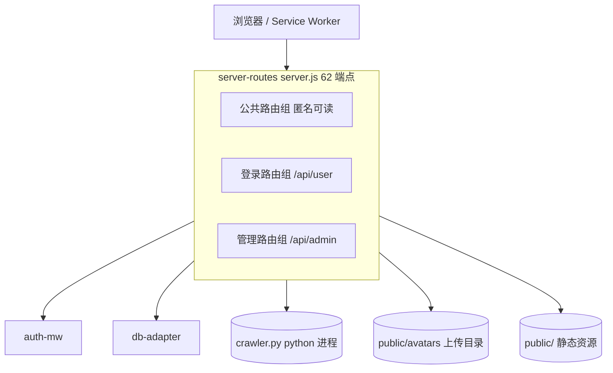
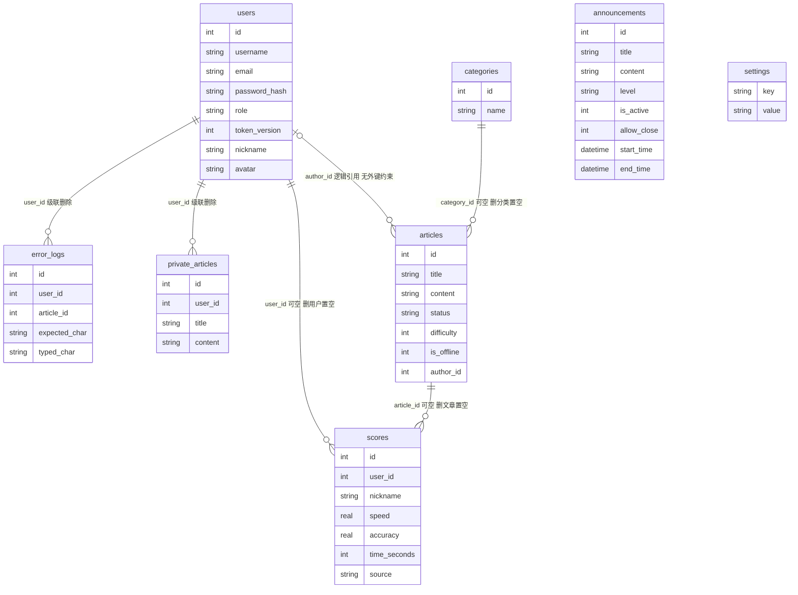
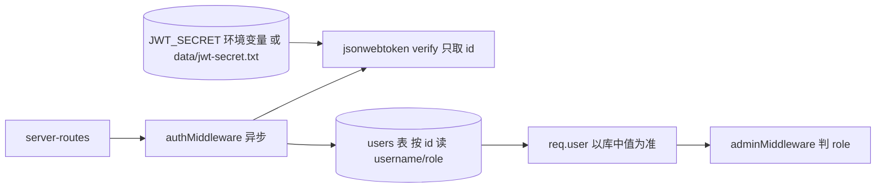
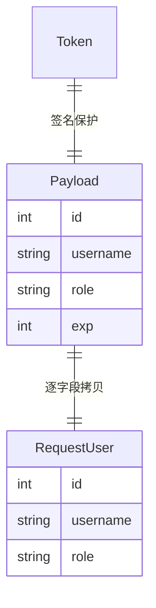
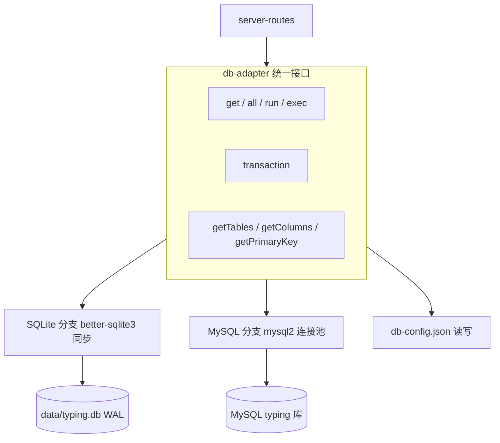
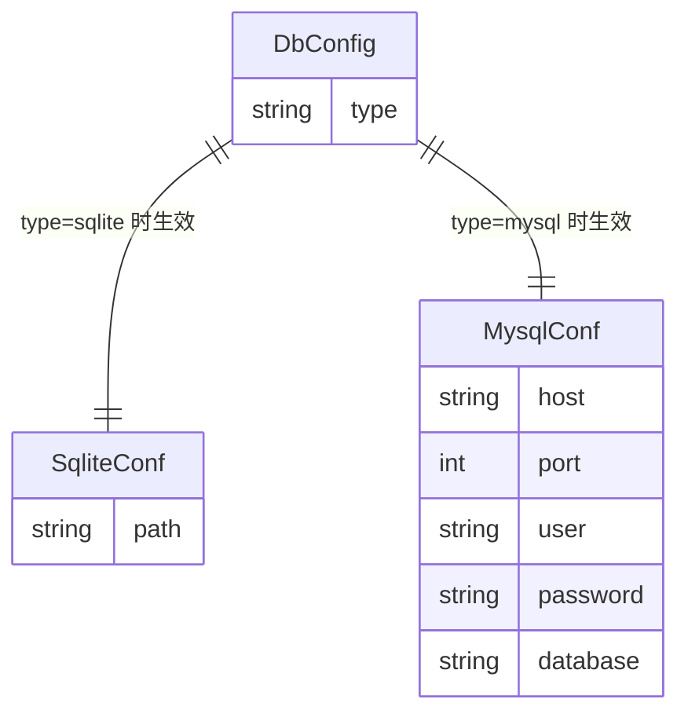
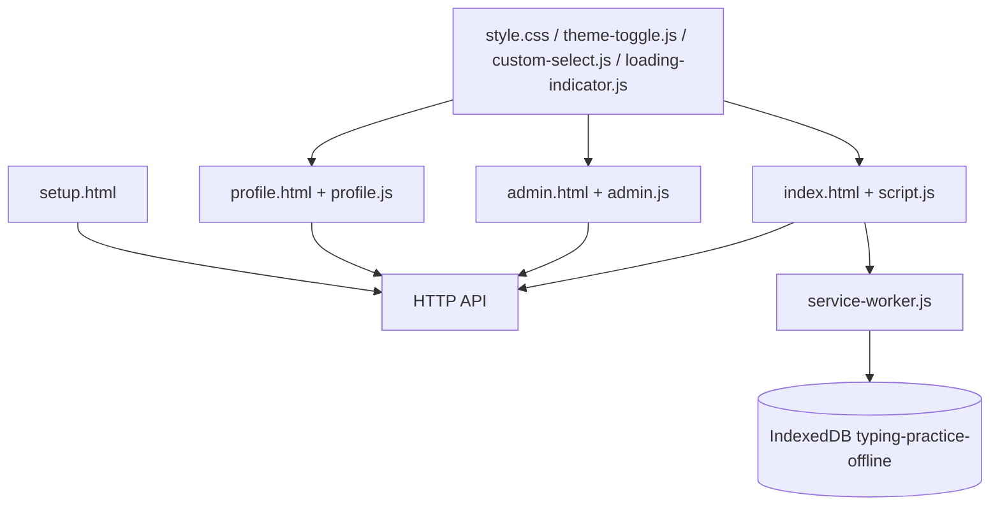
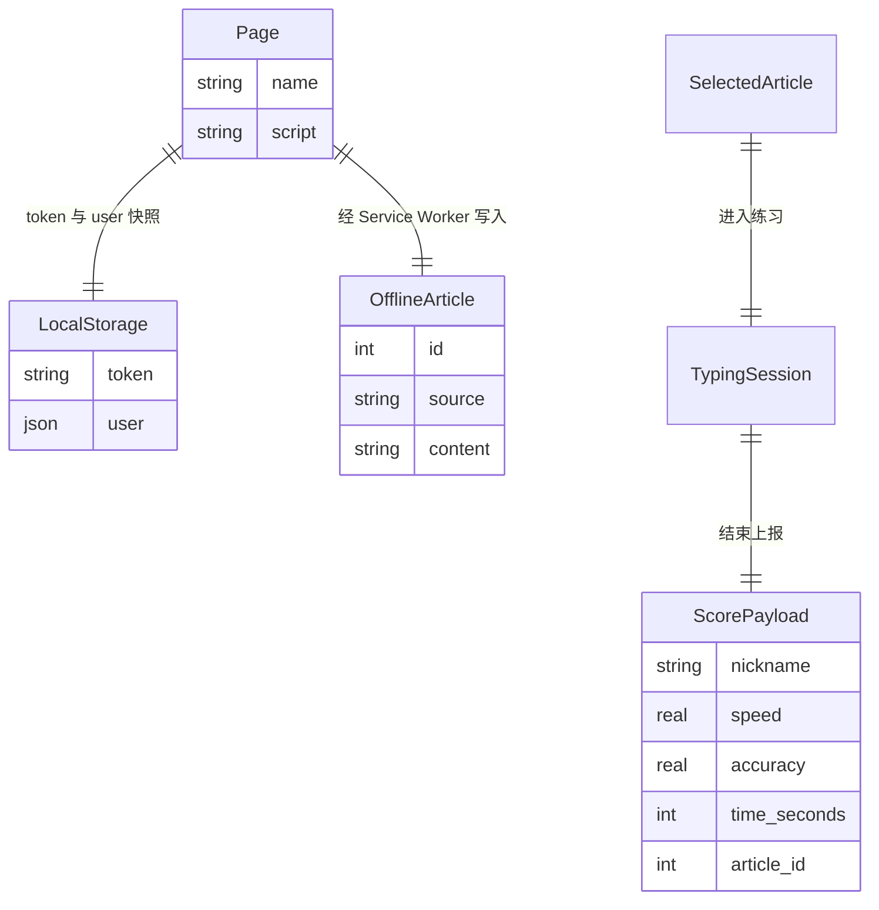

# 模块图

> 依据：源码里的结构定义。每次验收后更新；新增模块补两组图；数据结构变化只改数据关系图；依赖变化必须改位置图。
> 只画工作区里已经存在的模块。当前四个：server-routes、auth-mw、db-adapter、public-pages。

## server-routes（路由层）

### 位置图

边界：认识 HTTP 请求与 db-adapter 的九个方法，不认识具体数据库方言，不直接持有连接。被前端三个页面反向依赖——前端只能通过它访问数据。

### 数据关系图

关键约束：`password_hash` 从不对外返回（当前 `/api/admin/db/users` 违反此约束，见坑库 K-09）；`settings` 以 `key` 为主键、无自增 id，数据库面板不支持编辑该表主键；`articles.author_id` 没有外键，删用户时手工置空。

## auth-mw（鉴权中间件）

### 位置图

边界：只处理 `Authorization: Bearer` 头；payload 只用来取 `id`，权限一律以库中 `role` 为准（P3 起），用户不存在即 401；不写库、不碰业务。签名密钥来自环境变量或 `data/jwt-secret.txt`，无硬编码兜底（坑库 K-06 已结案）。改密码后旧 token 仍有效，属未结残留（K-05）。

### 数据关系图

约束：`role` 只有 `admin` / `user`，但**运行时以数据库为准**；`exp` 固定 7 天、无刷新机制；密钥来源为环境变量或 `data/jwt-secret.txt`（首启生成 32 字节随机值）；改密不使旧 token 失效（残留）。

## db-adapter（数据适配层）

### 位置图

边界：认识两种方言的 SQL 差异与元数据查询，不认识业务语义，不校验请求参数。上线时由 `initDatabase` 顺序执行建表 SQL、`runMigrations`、`seedData`。

### 数据关系图

约束：`db-config.json` 含明文 MySQL 密码，已进 `.gitignore`，不进日志、不回显完整值；配置文件只有一份真值（当前 `data/db-config.json` 是废弃副本，见坑库 K-12）。

## public-pages（前端页面）

### 位置图

边界：只通过 HTTP API 取数，不内嵌业务规则；本地只持久化 token（`localStorage`）与离线文章（IndexedDB）。

### 数据关系图

约束：`token` 7 天过期，前端不自动续期，401 时清 token 并跳回登录；上报的成绩包含 `article_id` 与服务端未复算的速度，见坑库 K-04。

## 维护规则

| 时机 | 做什么 |
| --- | --- |
| 每次验收后 | 更新对应模块两张图 |
| 数据结构变化 | 只改数据关系图 |
| 依赖变化 | 改位置图，并用依赖检查命令复核 |
| 图与代码冲突 | 改图 |
